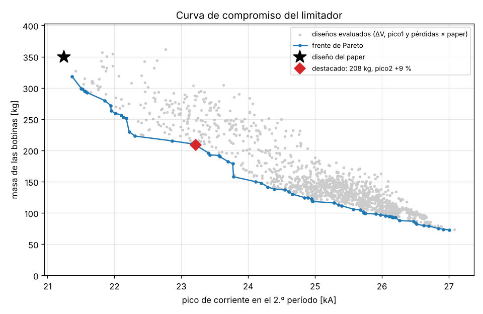
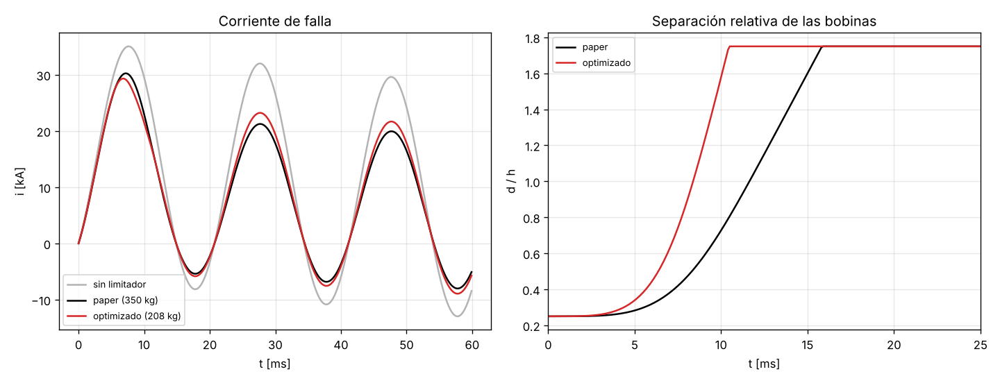
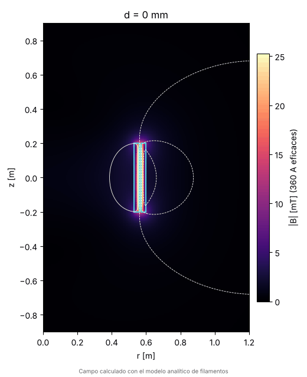
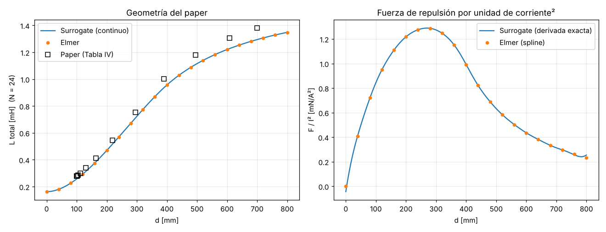
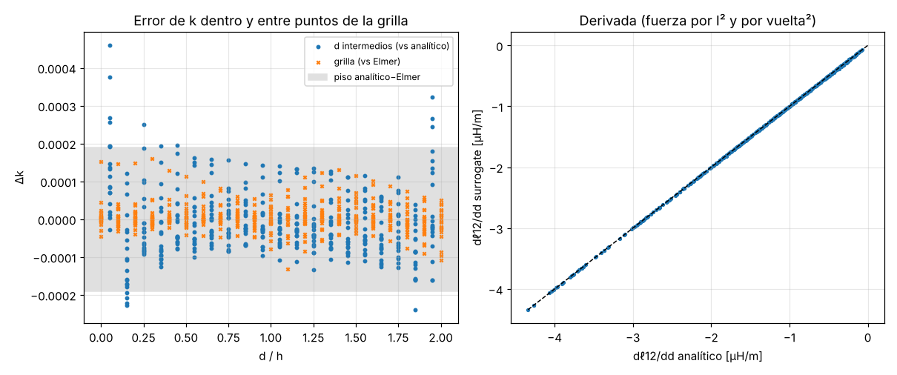
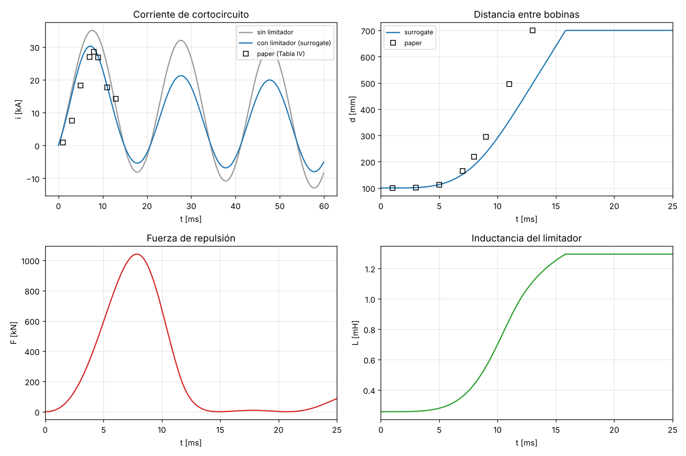

# ⚡ Limitador de corriente de falla: de FEM a IA y diseño inverso

**Una IA entrenada con ~3.000 simulaciones FEM de código abierto que simula y rediseña un limitador de corriente de falla, servida como API web.**

Reproduzco el limitador de núcleo de aire de *Amini, Damaki Aliabad y Amiri, "Design and Analysis of Fault Current Limiter Based on Air Core Variable Series Reactor", IEEE Access, 2021*. Lo simulo con GMSH + Elmer, entreno un modelo sustituto (*surrogate*) que lo evalúa ~10.000 veces más rápido, simulo la falla con ese modelo y lo uso para buscar mejores diseños.



## Resultado principal

- **No existe un almuerzo gratis.** Con cinco objetivos a la vez (caída de tensión, pico de falla en el 1.er y 2.º período, masa y pérdidas), no encontré ningún diseño mejor que el publicado en todos. El diseño del paper está sobre el frente de Pareto, o muy cerca.
- **Cediendo un poco en un solo objetivo se gana mucho en otro.** Si se acepta que el pico del 2.º período suba un 10 %, **la masa baja de 350 a 208 kg (−41 %)**, y el limitador **opera en 10,5 ms en vez de 15,8**. Todo eso sin empeorar la caída de tensión, el pico del 1.er período ni las pérdidas.

| | Paper | Optimizado (pico2 ≤ +10 %) |
|---|---|---|
| Geometría (ri, t_int, gap, t_ext, h) [mm] | 530 / 30 / 10 / 30 / 400 | 417 / 30 / 6 / 38 / 265 |
| Vueltas por bobina | 24 | 23 |
| Caída de tensión en servicio | 0,25 % | 0,22 % |
| Pico 1.er período | 30,2 kA | 29,3 kA |
| Pico 2.º período | 21,2 kA | 23,2 kA (+9 %) |
| **Masa de las bobinas** | **350 kg** | **208 kg** |
| Pérdidas en servicio | 2,33 kW | 2,33 kW |
| Tiempo de operación | 15,8 ms | 10,5 ms |

Otros puntos de la curva: con el pico2 hasta +5 %, la masa baja a 230 kg; con +20 %, a 111 kg.



## Cómo funciona

```
GMSH (.geo → .msh) → Elmer FEM (magnetostática axisimétrica) → dataset (2.961 casos)
        → surrogate (proceso gaussiano) → simulador de falla (RK4 vectorizado)
        → optimizador (evolutivo con restricciones) → API FastAPI + SQLite → Streamlit
```

### 1. Simulación FEM validada (`simulacion/`)
- Modelo axisimétrico de las dos bobinas coaxiales con GMSH + Elmer. Las inductancias se obtienen por energía y por flujo concatenado.
- **Malla elegida por convergencia de la energía magnética**, con extrapolación de Richardson (error estimado < 0,1 %). También se verifica el tamaño de la caja de aire y se comprueba la malla en geometrías extremas.
- Validación contra un **método independiente** (filamentos + integrales elípticas de Maxwell): coinciden dentro del 0,5 % en las 2.961 filas, con una mediana de 0,12 %.
- Contra el paper: L(d) reproduce la forma de la curva con un sesgo uniforme de −6 %, atribuible a modelar el bobinado como un bloque homogéneo.

<!-- Agregar acá los GIF generados por simulacion/fcl_gmsh_elmer.py y fcl_dataset.py:

 -->

### 2. Dataset (`datos/`)
- 121 geometrías de entrenamiento y 20 de prueba independientes (hipercubo latino, semillas distintas). Cada una tiene 21 distancias entre bobinas.
- Inductancias **por vuelta²**: el número de vueltas queda como variable de diseño libre, sin simular más.
- Controles de calidad por fila: reciprocidad ℓ₁₂ = ℓ₂₁ (error ~10⁻⁸) e invariancia de ℓ₁₁ con la distancia.

### 3. Surrogate (`fcl/surrogate.py`)
- **Variables adimensionales con sentido físico:** el coeficiente de acoplamiento k depende solo de cocientes geométricos (invariancia de escala), y una única función cubre la inductancia propia de las dos bobinas.
- Se comparó un proceso gaussiano con una red neuronal (MLP). Con este tamaño de dataset, el GP fue 3 a 8 veces más preciso (el script de entrenamiento repite la comparación si PyTorch está instalado).
- **La trampa que encontré:** sin restricciones, el GP acertaba en las 21 distancias simuladas pero fallaba entre ellas (error 0,46 en k). El conjunto de prueba no lo detectaba porque usa la misma grilla. Se corrigió acotando la escala de correlación y validando también en distancias intermedias contra el analítico.
- Para predecir solo necesita NumPy. La derivada (la fuerza) es analítica, no por diferencias finitas.

| Métrica (geometrías de prueba nunca vistas) | Error |
|---|---|
| Inductancia propia | máx. 0,02 % |
| L total del limitador | medio 0,006 %, máx. 0,10 % |
| Coeficiente k entre puntos de la grilla | máx. 4,6·10⁻⁴ (piso analítico vs FEM: 1,9·10⁻⁴) |
| Fuerza dℓ₁₂/dd | máx. 0,5 % del pico |
| Tiempo por evaluación | ~0,3 ms (Elmer: varios segundos) |




### 4. Simulador de la falla (`fcl/dinamica.py`)
- Resuelve la ecuación eléctrica y la mecánica acopladas del paper, **vectorizadas sobre miles de diseños a la vez** (RK4 de paso fijo): 1.000 diseños en unos 10 s.
- Coincide con `solve_ivp` sobre el modelo analítico: picos de 30,24 / 21,24 / 19,93 kA y 15,8 ms en ambos. Las pérdidas dan 2,33 kW, igual que el paper.



### 5. Optimizador (`fcl/optimizacion.py`)
Hipercubo latino más un algoritmo evolutivo simple. Minimiza un objetivo con límites en los demás y arma curvas de compromiso (frentes de Pareto en 2D). Es reproducible (semilla fija).

### 6. API y frontend
- `api/main.py` (FastAPI): `/inductancia`, `/simular-falla`, `/optimizar` y `/disenos` (CRUD sobre SQLite). Las entradas se validan con Pydantic dentro del rango del surrogate.
- `web/app.py` (Streamlit): sliders de geometría, simulación de la falla, optimización con restricciones e historial de diseños.

## Cómo correrlo

```bash
pip install -r requirements.txt
pytest -q                                   # tests
python estudio_optimizacion.py              # figuras y resultados de este README
uvicorn api.main:app --reload               # API → http://localhost:8000/docs
streamlit run web/app.py                    # frontend (en otra terminal)
```

Para regenerar todo desde FEM hace falta Elmer FEM instalado y `pip install -r requirements-simulacion.txt`:

```bash
python simulacion/fcl_validacion_python.py   # referencia analítica + dinámica (segundos)
python simulacion/fcl_gmsh_elmer.py          # prueba de GMSH + Elmer (minutos)
python simulacion/fcl_dataset.py             # dataset completo (1–3 h)
python simulacion/fcl_entrenar_surrogate.py  # surrogate (~5 min)
```

## Limitaciones (declaradas)
- **Bobinado homogeneizado:** con vueltas discretas, la inductancia en posición alineada puede variar hasta ~18 % según la sección del conductor, que el paper no informa.
- **Modelo cuasiestático:** no considera corrientes inducidas en los conductores. A 50 Hz, la profundidad de penetración en cobre (~9 mm) es comparable al conductor.
- **Mecánica:** el paper no publica resorte ni amortiguador. Las masas y la resistencia se escalan con la geometría, calibradas con los valores del paper.
- **Ángulo de falla:** se ajustó para reproducir los 35 kA sin limitador de la Tabla V. El paper no lo informa, y eso explica las diferencias en los primeros milisegundos.
- **Borde del dominio:** los diseños más livianos quedan en el límite del rango de entrenamiento (radio y altura mínimos). Ampliar el dataset es el paso siguiente.
- **Fuerza en d = 0:** por simetría debería ser exactamente cero; el surrogate da ~2 % del pico. La dinámica no pasa por ahí, porque arranca en d₀ = 0,25 h.

## Estructura

```
fcl/            surrogate, dinámica, optimización y servicio (núcleo, sin dependencias web)
api/            FastAPI + SQLite
web/            Streamlit
simulacion/     GMSH + Elmer, dataset, validación analítica y entrenamiento
modelos/        surrogate_fcl.npz (40 kB)
datos/          dataset de entrenamiento y prueba
docs/img/       figuras
tests/          pytest
```

---
Jorge Ariel Santillán — Ingeniero Electricista (UNAHUR) · Tecnicatura Universitaria en IA
